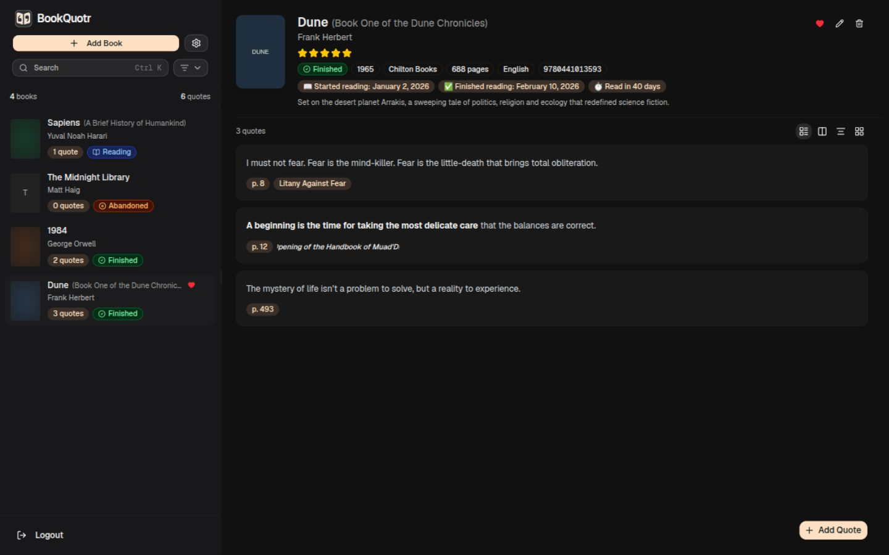
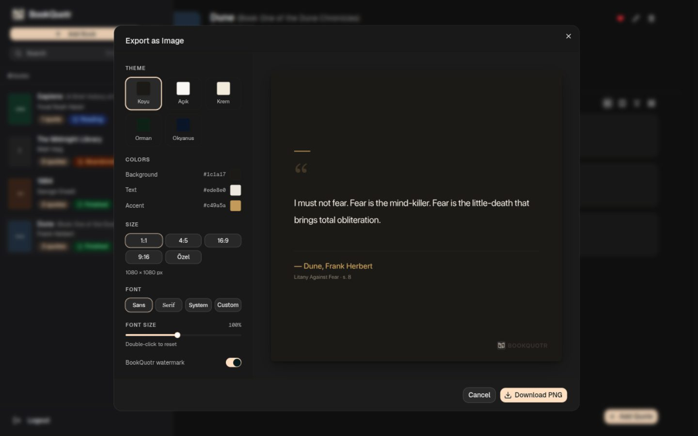
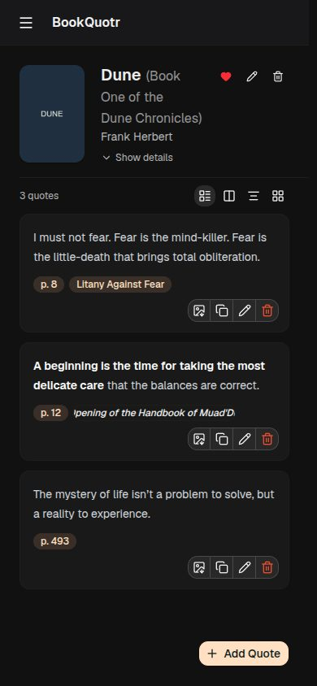

# BookQuotr

**A self-hosted, single-user home for your books and the quotes you love.**

BookQuotr keeps your reading library and memorable passages in one clean,
fast interface. Everything lives in a local SQLite file that you own — no
accounts, no cloud, no telemetry. Run it with Docker Compose in a couple of
minutes.

<p align="center">
  
</p>

---

## Features

- **Book library** — add books manually or import metadata from Google Books and
  Open Library. Track status (reading / finished / abandoned), ratings,
  favourites and reading dates.
- **Quotes with Markdown** — save passages with optional page, chapter and a
  private note. Content is rendered as Markdown.
- **Bulk import** — paste many quotes at once, separated by a `---` line.
- **Powerful search** — a `Ctrl/⌘ K` command palette searches your books and
  quotes, plus a field-aware search for new books (`title:`, `author:`, `isbn:`,
  `publisher:`).
- **Quote images** — export any quote as a shareable PNG with themes, colours,
  aspect ratios, fonts and an optional watermark.
- **Backup & restore** — export your whole library as JSON and import it again.
- **English & Turkish** — full UI localisation.
- **Dark & light themes**, adjustable font size, and several quote layouts.
- **Self-hosted and private** — optional authentication, sensible defaults, and
  an SSRF-hardened cover pipeline.

<p align="center">
  
  
</p>

---

## Quick start (Docker Compose)

**Prerequisites:** Docker with the Compose plugin.

1. Create a folder for BookQuotr and download the compose file and example env:

   ```bash
   mkdir bookquotr && cd bookquotr
   curl -O https://raw.githubusercontent.com/TaylanTatli/BookQuotr/master/docker-compose.yml
   curl -o .env https://raw.githubusercontent.com/TaylanTatli/BookQuotr/master/.env.example
   ```

2. Edit `.env` and set your credentials and a random secret:

   ```bash
   # generate a secret and paste it into AUTH_SECRET in .env
   openssl rand -base64 32
   ```

   ```env
   AUTH_USERNAME="admin"
   AUTH_PASSWORD="choose-a-strong-password"
   AUTH_SECRET="<paste the generated value>"
   ```

3. Start it:

   ```bash
   docker compose up -d
   ```

4. Open <http://localhost:3000> and sign in.

Your data is stored in `./data` next to the compose file (see
[Data storage](#data-storage--persistence)).

> **Runs without authentication?** Set `AUTH_ENABLED=false` in `.env`. This is
> intended only for a trusted, private network — anyone who can reach the server
> then has full access to your library. BookQuotr logs a warning at startup when
> auth is disabled in production.

### Prefer to build the image yourself?

```bash
git clone https://github.com/TaylanTatli/BookQuotr.git
cd BookQuotr
cp .env.example .env      # edit it, set AUTH_*
docker compose up -d --build
```

The published image is `ghcr.io/taylantatli/bookquotr:latest`. Pinned versions
are also published, e.g. `ghcr.io/taylantatli/bookquotr:0.1.4`.

---

## Authentication

Authentication is **enabled by default in production**. It needs three values:

| Variable        | Description                                              |
|-----------------|----------------------------------------------------------|
| `AUTH_USERNAME` | Login username.                                          |
| `AUTH_PASSWORD` | Login password. Use a long, unique password.             |
| `AUTH_SECRET`   | Random signing secret (≥ 32 chars) for session tokens.   |

Generate the secret with `openssl rand -base64 32` (or `node -e "console.log(require('crypto').randomBytes(32).toString('base64'))"`).

If auth is enabled but these are missing or the secret is too short, BookQuotr
refuses requests with a clear error (503) and logs the problem at startup —
there are no default credentials or fallback secrets.

- Sessions are signed JWTs stored in an `httpOnly`, `SameSite=Lax` cookie.
  The `Secure` flag is added automatically when served over HTTPS.
- Session lifetime defaults to 30 days (`AUTH_SESSION_DAYS`).
- Login attempts are rate-limited (5 failures per 15 minutes per IP).
- Disable authentication for a trusted local setup with `AUTH_ENABLED=false`.

Log out from the button at the bottom of the sidebar.

---

## Environment variables

| Variable               | Default                        | Description |
|------------------------|--------------------------------|-------------|
| `DATABASE_URL`         | `file:./data/bookquotr.db`     | SQLite database location. Keep it inside `./data`. |
| `AUTH_ENABLED`         | `true` in production           | Set to `false` to disable the login screen. |
| `AUTH_USERNAME`        | —                              | Required when auth is enabled. |
| `AUTH_PASSWORD`        | —                              | Required when auth is enabled. |
| `AUTH_SECRET`          | —                              | Required when auth is enabled (≥ 32 chars). |
| `AUTH_SESSION_DAYS`    | `30`                           | Session lifetime in days. |
| `PUBLIC_RANDOM_QUOTES` | `false`                        | When `true`, `GET /api/quotes/random` is public (never includes notes). |
| `GOOGLE_BOOKS_API_KEY` | —                              | Optional; raises the Google Books quota (100 → 1000 requests/day). |

In development, authentication is off by default unless you set
`AUTH_ENABLED=true`.

---

## Data storage & persistence

Everything is stored on disk, under `./data`:

| Path                       | Contents                              |
|----------------------------|---------------------------------------|
| `./data/bookquotr.db`      | The SQLite database (books and quotes). |
| `./data/covers/`           | Cached and uploaded cover images.     |

The Compose file mounts `./data` into the container at `/app/data`, so the data
survives container recreation and image updates. Keep this folder — it is your
entire library.

Database migrations run automatically every time the container starts
(`prisma migrate deploy`), so updating is safe.

---

## Backup & restore

**Full backup (recommended).** Stop the container and copy the whole data
folder; this includes cover images:

```bash
docker compose stop
tar czf bookquotr-backup-$(date +%F).tar.gz data
docker compose start
```

**Portable JSON backup.** In the app, open **Settings → Export JSON**. This
exports all books and quotes (including notes) to a single file. Restore it with
**Settings → Import JSON**; records are matched by their unique ids and
upserted, so importing into a non-empty library updates existing entries rather
than duplicating them.

> The JSON backup contains your review notes. Store it somewhere private.

---

## Updating an existing installation

```bash
cd bookquotr
docker compose pull
docker compose up -d
```

Migrations run on startup and are additive. To pin a version instead of always
using `latest`, set the image tag in `docker-compose.yml`, e.g.
`ghcr.io/taylantatli/bookquotr:0.1.4`.

**Before a major update,** take a backup of `./data` (above). It is always safe
to roll back by restoring the folder and running an older image tag.

---

## Local development

**Prerequisites:** Node.js 20.9 or newer (22 LTS recommended) and
[pnpm](https://pnpm.io) 11 (`corepack enable` honours the version pinned in
`package.json`).

```bash
pnpm install
cp .env.example .env
pnpm exec prisma migrate deploy   # create/update the local SQLite database
pnpm dev                          # http://localhost:3000
```

Useful commands:

```bash
pnpm typecheck   # TypeScript
pnpm lint        # ESLint
pnpm test        # node:test regression tests
pnpm build       # production build
pnpm start       # run the production build
```

The tests cover the security-critical helpers (cover id validation, SSRF URL
rules, image sniffing, credential comparison, import sanitisation, rate
limiting) and run against temporary fixtures — never your real data.

---

## Tech stack

- **Next.js 16** (App Router, Route Handlers) and **React 19**
- **TypeScript**, **Tailwind CSS v4**, **shadcn/ui** on **Base UI**
- **Prisma 7** with **SQLite** (via `@prisma/adapter-libsql`)
- **jose** for JWT session tokens
- **react-markdown** (sanitised) for quote rendering
- **Docker** / **Docker Compose**, published to GHCR
- **Google Books** and **Open Library** for optional metadata

---

## Security considerations

- **No default credentials or signing secrets.** Production requires explicit
  configuration and fails closed with a clear error if it is incomplete.
- **Centralised access control.** Every route except the login page, health
  check and static assets requires a valid session; cover images included.
- **SSRF-hardened covers.** Remote cover URLs must be public `http(s)` URLs;
  redirects are validated hop-by-hop, downloads are size-capped and images are
  verified by magic bytes. Uploads are likewise validated and size-limited.
- **Input sanitisation.** Book/quote writes and JSON imports only accept known
  fields with valid types, preventing mass assignment and unsafe thumbnails.
- **Baseline headers.** `X-Content-Type-Options: nosniff`, `X-Frame-Options:
  DENY` and a strict referrer policy are set on every response.
- **Keep it private.** Terminate TLS at a reverse proxy and do not expose the
  container directly to the internet. Treat `./data` and your `.env` as secrets.

Known limitations: the login rate limiter is in-memory (per container); there is
no built-in TLS or user management; BookQuotr is designed for a single trusted
user. See the license note below regarding network use.

---

## License & attribution

BookQuotr is licensed under the **GNU Affero General Public License v3.0**
(`AGPL-3.0-only`). See [LICENSE](LICENSE).

Because AGPLv3 is a network-copyleft license, if you run a modified version and
let others use it over a network, you must offer them the corresponding source
code.

**Created by Taylan Tatlı** — <https://github.com/TaylanTatli/BookQuotr>.

If you find BookQuotr useful, a star is appreciated.
